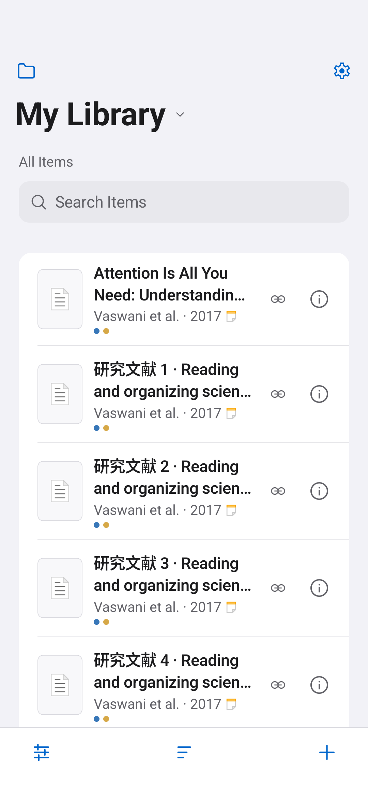
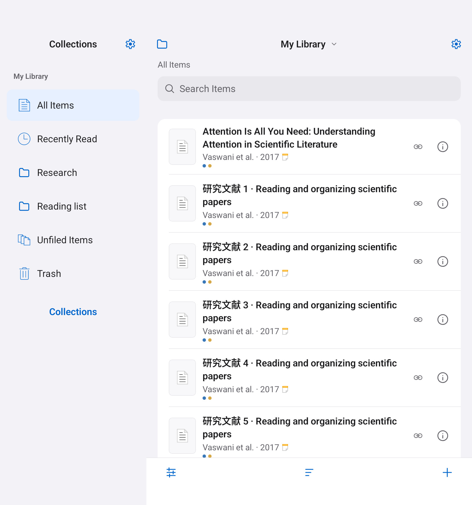
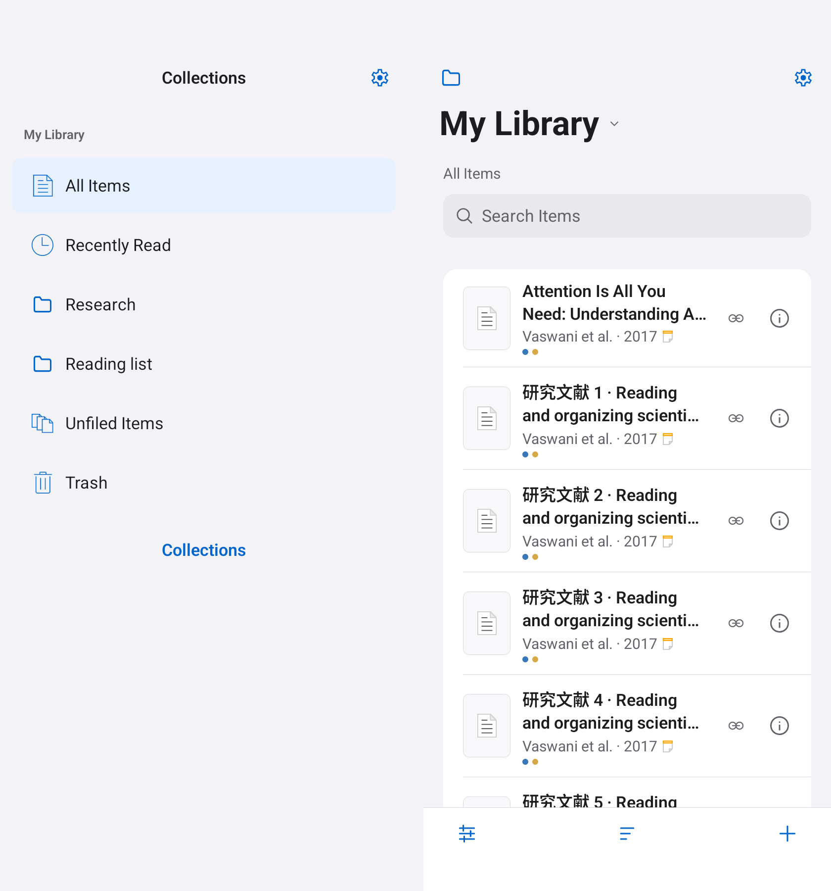
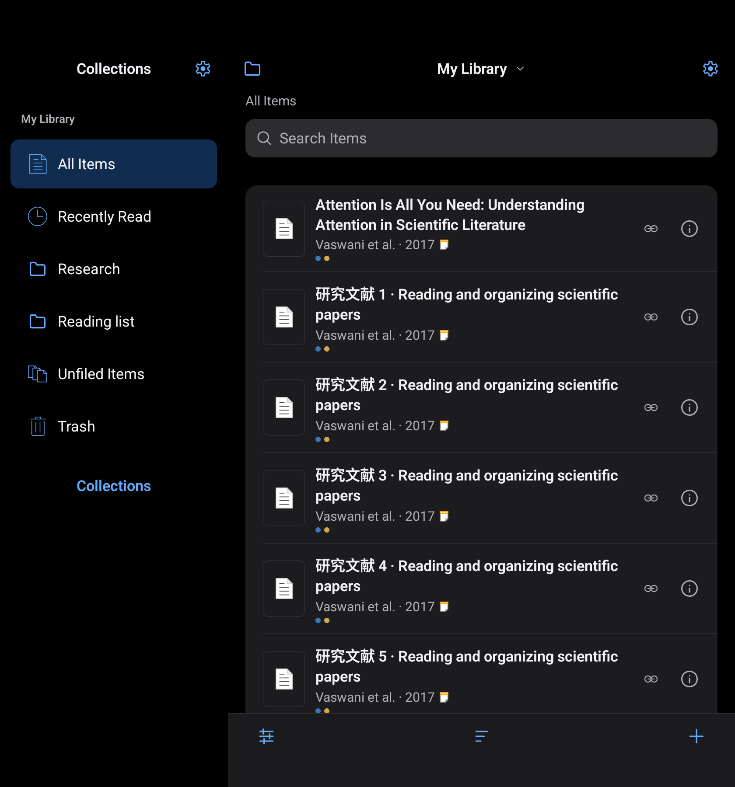

# Native interface and foldable layout

The app now shares one visual system across the library shell, onboarding,
sign-in, settings and reader controls. `LibraryTheme` and `AppThemeM3` use the
same colors, typography and shapes and also provide the legacy semantic theme.
The obsolete separate Material color catalog was removed.

The interface uses neutral grouped backgrounds, blue actions, 34sp large titles,
17sp body text, compact centered navigation, 14dp grouped sections and original
stroke icons. It keeps Android's system font and font scaling. Search, empty
states, list typography, bottom tools, account settings, Quick Copy and the
sign-in form share these rules. Narrow detail pages stack field labels and
values; wider pages place them side by side. Reader document content and
annotation colors retain their existing meaning.

## Adaptive behavior

The dashboard uses one navigation graph at every window size. Width changes no
longer replace the navigation controller. Home content stays in one composition
slot when its sidebar appears or disappears, preserving search and list state.
Restoring the activity no longer unconditionally scrolls the item list to zero.
Navigation protocol flags are separate from the available display width.

- Cover display or narrow multi-window: single column with a collection drawer.
- At least 760dp wide and 400dp tall: a 260–320dp collection sidebar and a
  remaining content pane. Content pages have a readable maximum width.
- Separating vertical fold: the sidebar and main pane fit on opposite sides of
  the fold when both fit. The hinge is reserved as a gutter.
- Insufficient room on either side, or a horizontal fold: each scaffold uses
  the larger unobstructed pane, with the top/left pane winning equal sizes.
- Fold bounds are translated from window coordinates to each nested scaffold.
  Separate dialog windows translate their screen offsets back to the activity
  window before avoiding a fold. Zero-width separating folds also count. Non-separating, non-occluding folds
  do not unnecessarily reduce the usable area.

Fold information comes from lifecycle-aware collection of Jetpack WindowManager
`WindowInfoTracker` and `FoldingFeature`, following the
[Android foldable guidance](https://developer.android.com/codelabs/android-window-manager-dual-screen-foldables).
The manifest permits activity resizing; classification uses available width and
height instead of the physical device's shortest dimension.

The pane policy lives in `architecture/ui/AdaptivePanePolicy.kt`; the Compose
integration is in `AdaptiveWindow.kt`. It does not need device model checks.

## Validation

Published build: [1.2.0-284](https://github.com/nicholashyang/zotero-android/releases/tag/dev-v1.2.0-284).
[Release acceptance](../RELEASE-1.2.0.md) includes the four-version CI matrix,
public APK checks and reviewed dependency advisory.

The local implementation passed 84 JVM tests and 74 UI checks across phone,
unfolded and landscape sizes on API 35. Four offline recovery tests also passed,
and a `1.1.0-283` to `1.2.0-284` install retained its data marker. See the adjacent
`native/` screenshots and logs. They are account-free examples
built from production components with synthetic library entries. Hinge examples
inject reported fold bounds into the same layout policy; they do not establish
hardware certification. Physical Fold/Flip devices, authenticated synchronization
and licensed PDF SDK behavior still need their normal device acceptance.

Reproduce with the local Android toolchain described in `../DEVELOPMENT.md` and
an isolated emulator:

```sh
bash gradlew --no-configuration-cache --max-workers=1 \
  -PuiTestRunner=org.zotero.android.library.LibraryTestRunner \
  :app:assembleDevDebug :app:testDevDebugUnitTest \
  :app:assembleDevDebugAndroidTest :app:lintDevDebug
```

The JVM policy tests cover compact and unfolded windows, density, short windows,
real-width hinges, zero-width folds, nested coordinates and tabletop layouts.
The Compose tests check content-state continuity during repeated resizing, safe
pane bounds, centered-dialog window offsets, and production-component previews in light and dark appearance.
The existing search, selection, login, gesture, cover and formula checks remain
part of the UI regression suite.

Recreate the three-size capture matrix with:

```sh
ANDROID_SERIAL=emulator-5556 bash scripts/capture_native_ui.sh .local/native-captures
```








